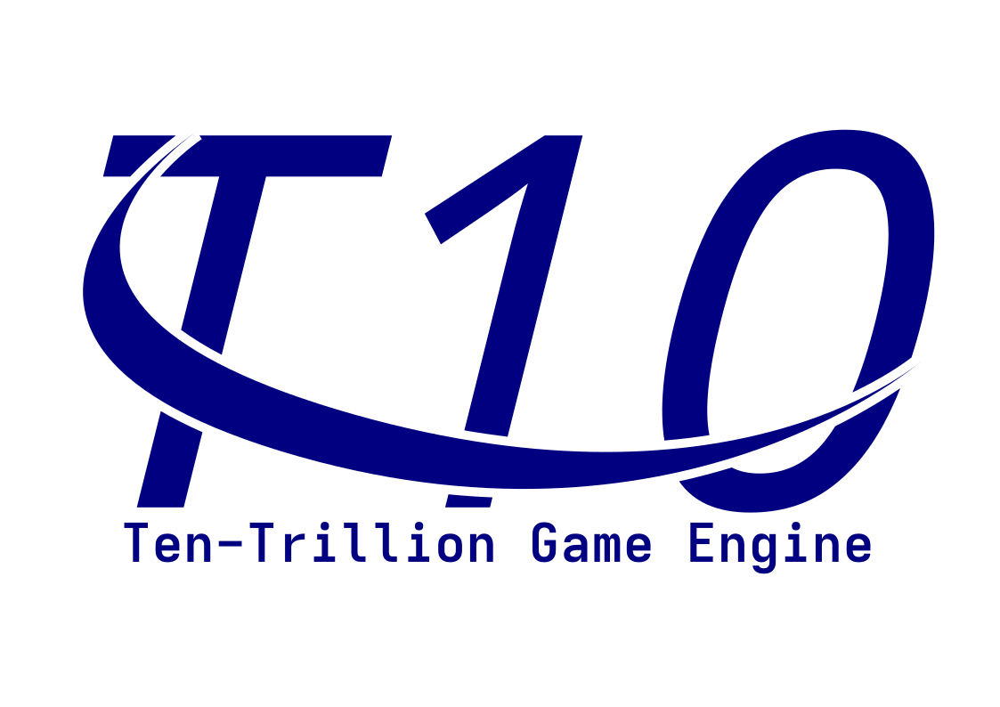

# The TenTrillion Game Engine

The TenTrillion Game Engine is an optimized game engine meant for extremely quick rendering and fast performance.

The main goal of the TenTrillion, is to provide optimizations for games, so developers don't have to write them
manually.

## License

This project uses the MIT License. Check out the [LICENSE](LICENSE) file for more information.
