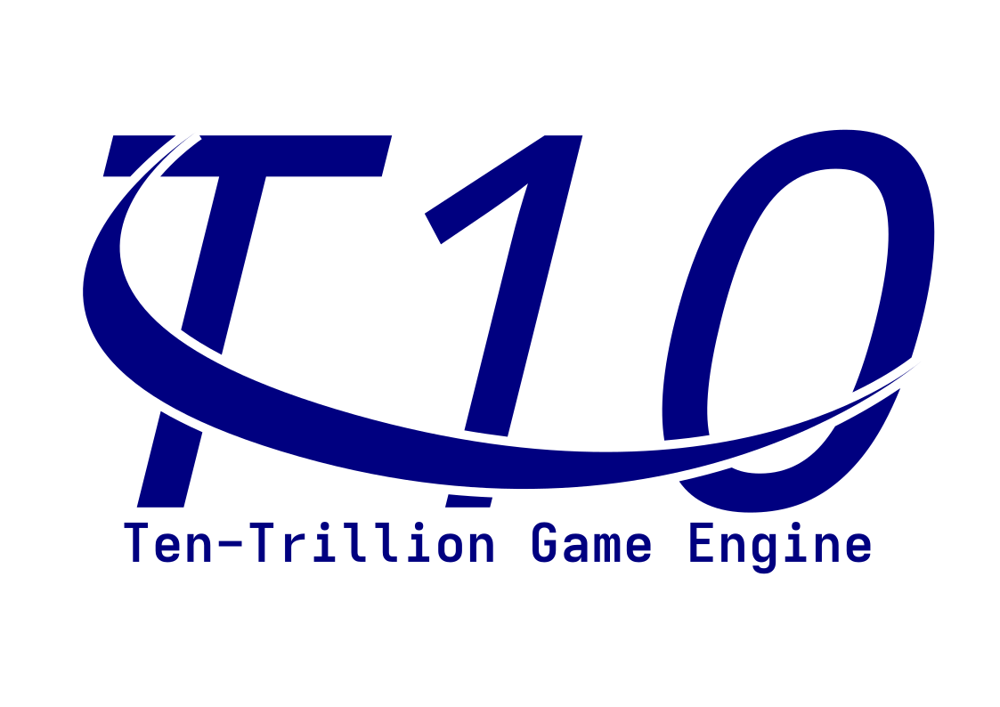

# The TenTrillion Game Engine

The TenTrillion Game Engine is an optimized game engine meant for extremely quick rendering and fast performance.

The main goal of the TenTrillion, is to provide optimizations for games, so developers don't have to write them
manually.

## Sections

The TenTrillion Game Engine is split into different sections depending on which renderer is used for the specified section.

- `/vulkan` - is the Vulkan/TenVulkan library. This is for the Vulkan Backend, the primary and main backend of the engine.

- `/opengl` - is the OpenGL/TenGL library. This is for the OpenGL Backend, the secondary backend of the engine.

- `/directx` - is the DirectX/TenX library. This is for the DirectX Backend, the secondary backend of the engine for users that use Windows.

- `/compat` - is the Compatibility library. This is for the old DirectX/OpenGL Backends, the optional backend of the engine.

- `/editor` - is the Editor of the TenTrillion that allows you to easily make games. _Your computer must be compatible with all the backends of your specified platform. For example, Windows users' computers' must support DirectX, Vulkan and OpenGL, meanwhile Linux users' computers' must support Vulkan and OpenGL._

## Details about DRM/WDDI Control

The TenTrillion Game Engine has the ability to take over a specified display and use it completely for rendering, for maximum performance. This is for Vulkan users only,
as of now. This is achieved by grabbing DRM directly from the Linux Kernel, or the WDDI from the Windows NT Driver Model.

## Requirements

### Vulkan:

- C++17 (C++ 2017)
- CMake 3.16.0
- Vulkan SDK
- OpenAL SDK
- OpenCL SDK

### OpenGL

- C++17 (C++ 2017)
- CMake 3.16.0
- OpenGL SDK
- OpenAL SDK
- OpenCL SDK

### DirectX (Windows Only)

- C++17 (C++ 2017)
- CMake 3.16.0
- DirectX SDK
- OpenAL SDK
- OpenCL SDK

### Compatibility

- C90
- Makefile Support

_(The SDL Library will be pre-provided by the TenTrillion and will be compiled alongside with the Compatibility SDK.)_

### Editor

- C++17 (C++ 2017)
- CMake 3.16.0
- Qt Ver.5.
- _Requirements for the same as Vulkan, OpenGL, DirectX (Windows Only), Compatibility Sections._

## License

This project uses the MIT License. Check out the [LICENSE](LICENSE) file for more information.
